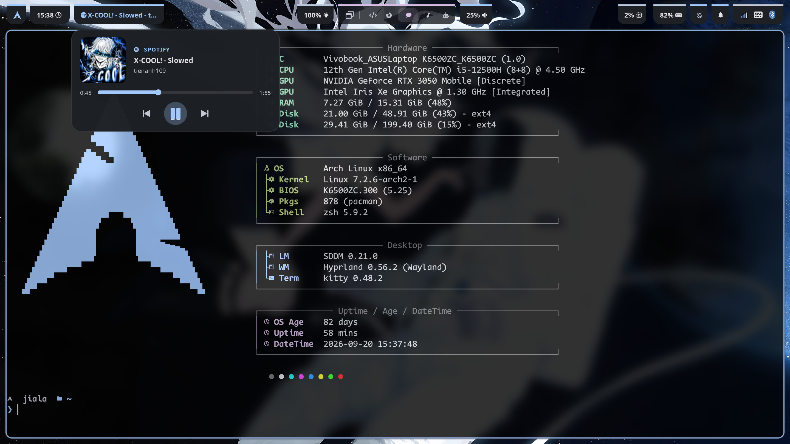
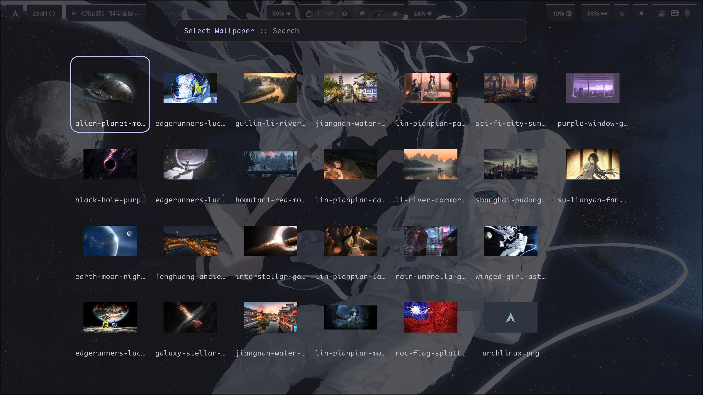
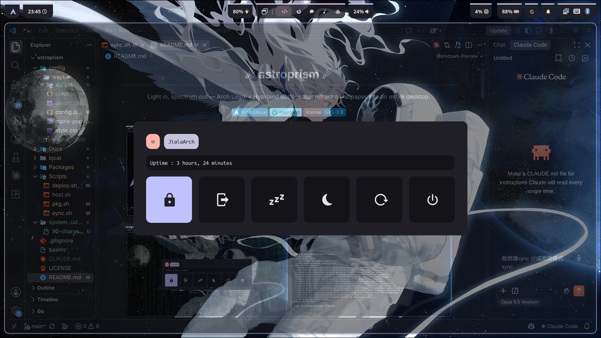
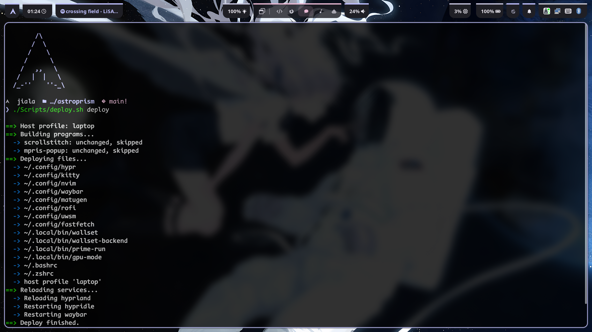

<h1 align="center">☄ astroprism ☄</h1>

<p align="center">
  Light in, spectrum out — Arch Linux + Hyprland dotfiles that refract a wallpaper into an entire desktop.
</p>

<p align="center">
  
  
  
</p>

<p align="center">
  
  
</p>

<p align="center">
  
  
</p>

##  Features

- **Wallpaper-driven theming** — pick a wallpaper, the whole desktop recolors itself via [matugen](https://github.com/InioX/matugen) (Material You), light or dark
- **Custom MPRIS popup** — cover art and playback controls, one click from the bar
- **Workspace overview** — a fullscreen grid of live window thumbnails
- **Screenshot applet** — desktop/window/area/timed shots, screen recording, and scroll capture that stitches a scrolling page into one tall PNG
- **Reproducible installs** — exported package lists and deploy/sync scripts get the setup back in a few commands, on either machine

## What's inside

| Part | Choice |
|---|---|
| WM | [Hyprland](https://hypr.land/) — configured in **Lua** (`hyprland.lua`) |
| Bar | Waybar |
| Workspace overview | [hyprexpose](https://github.com/ThiagoAVicente/hyprexpose) |
| Launcher / menus | Rofi (launcher, applets, wallpaper picker) |
| Terminal | Kitty |
| Editor | Neovim (LazyVim & Neovide) |
| Shell | zsh + starship (bash config kept as fallback) |
| Notifications | swaync |
| Lockscreen | hyprlock |
| Wallpaper | awww + `wallset` script |
| Theming | [matugen](https://github.com/InioX/matugen) |
| Display manager | SDDM (`sddm-astronaut-theme`) |
| Input method | fcitx5 + chewing |

## Repo layout

```
config/      → ~/.config/…        (hypr, kitty, nvim, waybar, swaync, matugen, rofi, uwsm, fastfetch, wallpapers)
config/hosts/→ per-machine values (see Host profiles below)
local/bin/   → ~/.local/bin/…     (wallset, wallset-backend, gpu-mode, prime-run)
programs/    → ~/.local/bin/…     (mpris-popup, scrollstitch — sources, built by deploy.sh)
system/      → /etc/…             (udev + systemd units, copied by hand with sudo)
bashrc/zshrc → ~/.bashrc, ~/.zshrc
Packages/    → exported package lists, one dir per host profile
Scripts/     → deploy.sh, sync.sh, pkg.sh
Docs/        → screenshots + manual-setup.md (the root-only bits deploy.sh can't write)
```

## Host profiles

The desktop and the laptop want different font sizes, gaps, waybar modules and swaync sizing. Rather than keeping a
branch per machine, those values live in `config/hosts/<profile>/` and `deploy.sh` copies them into
place as `host.*` files that the main configs pull in.

Both machines share a hostname, so the profile is stored in `~/.config/astroprism-host` instead of
being detected. Pass it once to set or change it:

```sh
./Scripts/deploy.sh deploy laptop   # writes ~/.config/astroprism-host, then deploys
./Scripts/deploy.sh deploy          # later runs reuse it
```

The profile also picks the package lists (`Packages/<profile>/`), so each machine's `pkg.sh export`
records its own hardware instead of overwriting the other's.

The deployed `host.*` files are `sync.sh`-excluded and gitignored — edit
`config/hosts/<profile>/` instead. To add a machine, copy an existing profile directory and deploy
with its name.

## Installation

> [!WARNING]
> These are personal dotfiles, not a distro. `deploy.sh deploy` **overwrites** existing configs without backing them up — run `deploy.sh backup` first if you want a copy — and the package lists include desktop apps like Discord, Spotify and VS Code. Read the scripts and trim `Packages/<profile>/` before running anything.

```sh
# 0. install base system and yay first
sudo pacman -S --needed base-devel git
git clone https://aur.archlinux.org/yay.git /tmp/yay && (cd /tmp/yay && makepkg -si)

# 1. clone this dotfile
git clone git@github.com:JialaChang/astroprism.git
cd astroprism

# 2. deploy configs (builds the Rust/Go helpers first, needs cargo + go)
./Scripts/deploy.sh backup            # optional: saves existing configs as *.backup
./Scripts/deploy.sh deploy desktop    # profile: desktop | laptop

# 3. install everything from this profile's lists
./Scripts/pkg.sh install        # failures are logged to Packages/pkg-failed.txt

# 4. set a wallpaper — this also generates the whole color scheme
wallset
```

## Scripts

| Script | What it does |
|---|---|
| `deploy.sh backup` | Backs up every target as `*.backup`; run manually before `deploy` if you want a safety copy |
| `deploy.sh build` | Compiles `mpris-popup` (cargo) and `scrollstitch` (go); each target is stamped with a hash of its sources + build command, so an unchanged tree skips the compiler |
| `deploy.sh deploy [profile]` | `build`, then repo → system: copies all configs into `~/.config`, `~/.local/bin`, dotfiles into `~`, applies the host profile, then reloads Hyprland, waybar, hypridle and swaync |
| `sync.sh` | System → repo: pulls current configs back in (needs `rsync`) and re-exports package lists (run before committing) |
| `pkg.sh export` | Writes explicitly-installed packages to `Packages/<profile>/` (debug pkgs excluded) |
| `pkg.sh install` | `pacman -Syu`, then installs this profile's lists; failures go to `Packages/pkg-failed.txt` |

> Both scripts *replace* whole directories with `rsync --delete` rather than merging.
> `deploy.sh` leaves matugen's generated colors and the `host.*` files in place; `sync.sh` skips
> `host.*` and build output. Delete `.deploy-stamps/` to force a rebuild.

## Dynamic theming

The whole desktop is re-colored from the current wallpaper:

```
wallset (rofi picker with previews, then a color-strategy row)
  └─ wallset-backend <image> [--prefer strategy]
       ├─ awww img …                  # animated wallpaper switch
       ├─ matugen image … --mode … --prefer …   # generate colors from the image
       │    └─ templates → hyprland, kitty, rofi, waybar, swaync, btop, starship, GTK 3/4, hyprexpose
       ├─ restart waybar, reload swaync
       └─ remembers wallpaper in ~/.cache/last_wallpaper
```

- Templates live in `config/matugen/templates/`, targets are wired up in `config/matugen/config.toml`.
- `waybar/scripts/theme-toggle.sh` re-runs matugen in light/dark mode on the last wallpaper.
- The current mode and color strategy are kept in `~/.cache/theme_mode` and `~/.cache/theme_prefer`.

## Waybar MPRIS popup

Click the mpris module → a popup with cover art and playback controls. Written in Rust
(`programs/mpris-popup/`), built by `deploy.sh` and installed to `~/.local/bin/mpris-popup`,
which waybar's `on-click` runs.

## Waybar workspaces

The workspaces module is `ext/workspaces`, not `hyprland/workspaces`, whose clicks send a legacy
dispatch string the Lua config rejects. Workspaces 1–5 are kept alive by persistent
`workspace_rule`s in `hyprland.lua` instead of `persistent-workspaces`.

## Screenshot applet

`Super+F` opens the rofi screenshot menu; `Ctrl+Shift+F` goes straight to an area shot. Shots are saved to `~/Pictures/Screenshots` and copied to the clipboard.

- Desktop / window / area / timed shots via grim + slurp.
- **Scroll capture** — start recording a region, scroll through the content, open the menu again to stop; the recording is piped through ffmpeg as raw RGBA straight into `scrollstitch`, a small Go tool in `programs/scrollstitch/` that overlaps the frames into one tall PNG. Built by `deploy.sh` and installed to `~/.local/bin/scrollstitch` (needs `go`).
- **Screen recording** — toggle a region recording, saved to `~/Videos/Screencasts`.

## Credits

- Parts of this setup adapted from [Noro18/linux-ricing-dotfiles](https://github.com/Noro18/linux-ricing-dotfiles)
- Rofi launchers & applets based on [adi1090x/rofi](https://github.com/adi1090x/rofi)
- [matugen](https://github.com/InioX/matugen) for Material You color generation
- [hyprexpose](https://github.com/ThiagoAVicente/hyprexpose) for the workspace overview
- [LazyVim](https://www.lazyvim.org/) as the Neovim base
- [sddm-astronaut-theme](https://github.com/Keyitdev/sddm-astronaut-theme)
